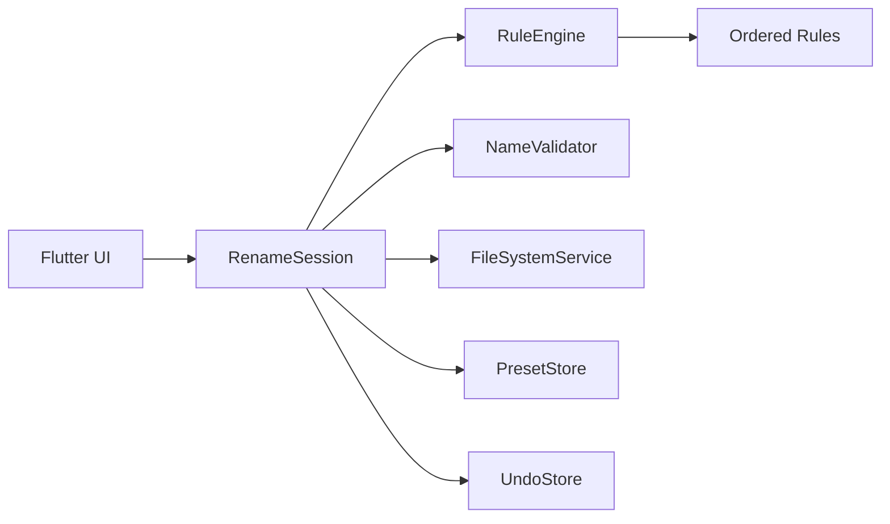

# FileRenamer — iterative Flutter desktop plan

Build **filerenamer** as a Flutter desktop app (Windows/macOS/Linux) in six vertical iterations: shell + file intake, rule engine + preview, validation + apply, rule list UX, presets, then undo — each iteration ships a runnable slice.

Blank Flutter desktop project at `e:\projects\Renamer\renamer` (counter demo only). **App name: filerenamer** (display name + `pubspec` package rename). Keep Windows/macOS/Linux runners; develop primarily on Windows.

## Todos

- [x] Iteration 1: rename to filerenamer, file pick/drop, identity preview shell
- [x] Iteration 2: RuleEngine + prefix/suffix/replace/remove/case + live preview
- [x] Iteration 3: numbering/date/ext-case, validation, two-phase apply
- [x] Iteration 4: drag-reorder, disable, delete rules
- [x] Iteration 5: save/load/import/export presets
- [x] Iteration 6: persist last mapping + undo restore

## Architecture



- **Pure Dart core** under `lib/core/` — rules, pipeline, validation, preview mapping. Unit-tested with no Flutter/IO so iterations stay fast.
- **IO adapters** under `lib/services/` — pick/drop files, rename on disk, JSON for presets/undo.
- **UI** under `lib/ui/` — three-pane desktop layout: file list / rule stack / preview + actions.
- **State**: single `ChangeNotifier` (`RenameSession`) via `provider` — enough for a tool app without over-engineering.

### Rule model (shared across iterations)

```dart
sealed class RenameRule {
  String id;
  bool enabled;
  String apply(String name, RenameContext ctx); // basename only; extension handled by rule type
}
```

Rules run **in list order**; disabled rules are skipped. Preview = fold over enabled rules for each file.

| Rule | Behavior |
|------|----------|
| Prefix / Suffix | Insert fixed text |
| Remove chars | Remove N chars from start or end of stem |
| Find & replace | Literal replace (optional regex later) |
| Case (name) | lower / UPPER / Title / camel |
| Numbering | `{n}` with start, step, zero-pad |
| Insert date | Configurable pattern (e.g. `yyyy-MM-dd`) at start/end/position |
| Extension case | lower / UPPER extension only |

### Collision / validity gates

Block **Apply** when any preview name is empty, contains invalid path chars (`<>:"/\|?*` + control), ends with `.`/` `, or collides with another target **or** an existing sibling file not being renamed away. Mark rows in the preview table.

### Persistence

- Presets: `%APP_SUPPORT%/filerenamer/presets/*.json`
- Undo: last successful batch mapping `{from, to}[]` in `%APP_SUPPORT%/filerenamer/undo/last.json` (single-level undo of last run; enough to recover bulk mistakes)

### Key packages

`desktop_drop`, `file_picker`, `path`, `path_provider`, `provider`, `uuid` (rule ids), `intl` (dates).

## UI shell (from iteration 1)

- Header: **FileRenamer** + Open / Clear / Apply / Undo
- Left: dropped/selected files (path + current name)
- Center: ordered rule cards (add menu grows over iterations)
- Right / bottom: live **Original → New** table with error highlights
- Drag-drop onto window via `desktop_drop`; multi-select via `file_picker`

---

## Iteration plan (stop after each for your review unless you say “continue”)

### Iteration 1 — Project identity + file intake + identity preview

- Rename package/display to **filerenamer**; replace counter demo.
- Models: `RenameFile` (path, originalName), session holds file list.
- Drag-drop + file picker; clear list.
- Preview table showing original = new (no rules yet).
- Skeleton panes so later UI plugs in without rework.

**Done when:** you can drop/select files and see them listed with a live preview column.

### Iteration 2 — Rule engine + first rules + live preview

- Implement `RuleEngine` + enable/disable in data model.
- Ship: **prefix, suffix, find/replace, remove N chars, name case**.
- Wire “Add rule” and per-rule editors; preview updates on every edit.

**Done when:** chaining those rules updates the preview correctly (covered by unit tests).

### Iteration 3 — Numbering, date, extension case + validation + apply

- Add **numbering**, **insert date**, **extension case**.
- `NameValidator` + row error UI; disable Apply when invalid.
- `FileSystemService.renameAll` with two-phase rename if needed (temp names) to avoid clobbering on Windows when swapping names.
- Confirm dialog before apply; success/failure summary.

**Done when:** safe renames on disk; collisions/invalid names block Apply.

### Iteration 4 — Rule list UX

- Drag-reorder rules, delete, toggle disable (skip in pipeline).
- Compact rule cards with clear summary text.

**Done when:** reorder/disable/delete immediately change preview.

### Iteration 5 — Presets

- Save current rule stack as named preset; load / delete.
- Import / export preset JSON (file picker save/open).

**Done when:** round-trip a preset file and reload after app restart.

### Iteration 6 — Undo

- Persist last batch mapping after successful apply.
- Undo restores previous names (validate targets free; same collision gates).
- Clear or disable Undo when nothing to undo.

**Done when:** apply → undo restores the prior names for that batch.

---

## Suggested layout after iteration 1

```
lib/
  main.dart
  app.dart
  core/
    models/          # RenameFile, RenameRule sealed types, Preset, UndoMapping
    engine/          # RuleEngine, RenameContext
    validation/      # NameValidator
  services/
    file_system_service.dart
    preset_store.dart
    undo_store.dart
  state/
    rename_session.dart
  ui/
    home_page.dart
    widgets/         # file_list, rule_list, preview_table, ...
test/
  core/              # engine + validation unit tests first
```

## Defaults locked for this plan

- Flutter desktop only (existing project); no mobile/web.
- Literal find/replace in v1 (no regex until requested).
- Single last-batch undo (not a full history stack).
- Files only (not recursive folder rename).
- Pause after each iteration for review.
